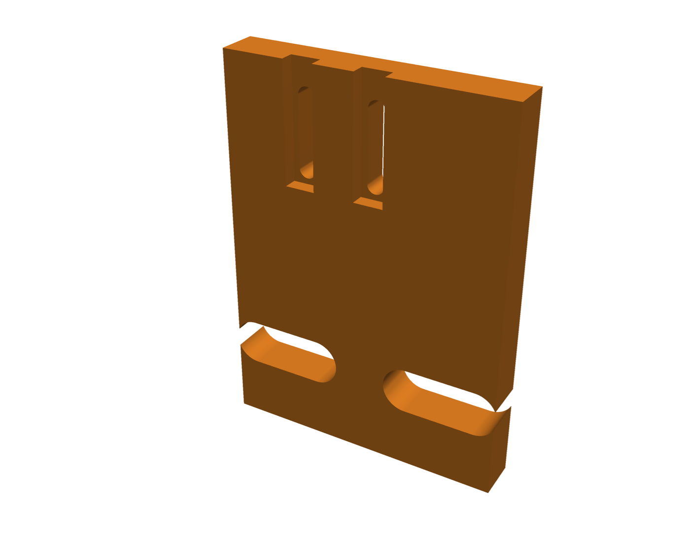

# Limit-switch mounts (LIM_NEAR, LIM_FAR) — PROPOSED

The v3e frame had no limit-switch mounts (checked against all 24 solids of
`../v3e/full_assembly_layout.step`; the CAD README listed it as open item 1). This adds one
bracket design, printed twice, for Mathew's mini roller-lever microswitch (SS-5GL / KW10 size).

## How it works

- The bracket bolts to the **-Y side slot** of the 4040 with 2x M6 + side-slot T-nuts at
  z = -20, same as the other blocks. The slots are 10 mm long, giving ±5 mm along X.
- The switch hangs outside the extrusion, under the **76 mm-wide overhang** of the moving
  parts. The bottom edge of the clamp block or nut plate rolls onto the roller, and the roller
  then rides on the flat underside. Overtravel never drives anything into the switch body:
  82 mm and 59 mm of underside are available, against at most 48 mm and 14.8 mm of travel
  past the trip points.
- The switch is held by **2x M2** through its O2.55 holes. The plate slots are O2.4 and 10 mm
  long vertically (±5 mm height adjustment). The M2 nuts slide into hex tracks on the back face
  from the top edge, so they are still through-bolts, with no inserts.
- **Heights:**
  - Strike face: 27.89 mm above the extrusion top, measured with calipers (matches HGH15CA
    H = 28 and the CAD).
  - Roller, lever free: 24.36 mm above the terminal pin tips. Fully pressed: 19.81 mm, so
    4.55 mm of total travel.
  - The block presses the roller **2.5 mm**, leaving 2 mm before it bottoms out.
- **Install:** slide the switch up until it clicks with the block over it, then about 0.5 mm
  further, and tighten.

| Switch | Struck by | Trip point | Margin to hard stop |
|---|---|---|---|
| LIM_NEAR (J4) | clamp block on carriage 1, -X face | jaw gap ≈ 77 mm (3 mm past G0 = 80) | 48 mm before the clamp block reaches the floating block |
| LIM_FAR (J5, also the homing switch) | nut plate on carriage 2, +X face | 320 mm of travel (+X face at x = 637.2) | 14.8 mm before carriage 2 reaches the rail end |

Bracket positions: LIM_NEAR x 33.1..73.1, LIM_FAR x 608.1..648.1. LIM_FAR sits 7 mm clear of
the BK10 block (x = 655).

## Checked

Every bracket and switch body against every v3e solid, with the moving group (carriages,
clamp block, jaws, cell, studs, nut plate, ball nut) at 0, +320, +334.76 (rail end) and
-48 mm: **no collisions**. The only overlap is the free-position lever with its own striker,
at and beyond the trip point, by the intended 2.5 mm press.

## Measured vs still assumed

Measured by Mathew (2026-11-19):
- strike height 27.89 mm;
- body length 19.81 mm and thickness 6.07 mm;
- mounting holes O2.55 at 10.00 mm centres;
- roller top above the pin tips: 24.36 mm free, 19.81 mm fully pressed.

Still TODO(verify):
- Pin length below the body (4 mm, photo estimate). This only moves where the holes fall in
  the ±5 mm slots, not the roller height.
- Hole height on the body (3.0 mm assumed; the ±5 mm slots absorb it).
- Body height (10.2 mm assumed, cosmetic) and roller size (cosmetic).
- The switch's click point within its 4.55 mm travel. It has to come before the 2.5 mm press;
  set it at install.
- **Strike height at the block's outer edge.** 27.89 mm is the underside over the carriage. If
  the printed block is lower at its outer edge, where the roller runs, the press grows by the
  same amount. Up to 2 mm lower is safe; more than that, move the switch down in its slots.
- 4040 slot width (only changes the T-nut).
- Trip points are proposals: firmware soft limits should sit inside them.
- Wiring: NC contact (C to NC) to GND, as the controller board expects (J4/J5).

## Files

- `build.py`: parametric source (build123d 0.13). Regenerates everything below.
- `lim_near_bracket.step/.stl`, `lim_far_bracket.step/.stl`: identical part, each at its
  assembly position. Print 2 in PETG, back face down (the nut tracks need no supports).
- `lim_*_switch_placeholder.step`: switch body + lever, for clearance checks only.
- `images/`: renders.
