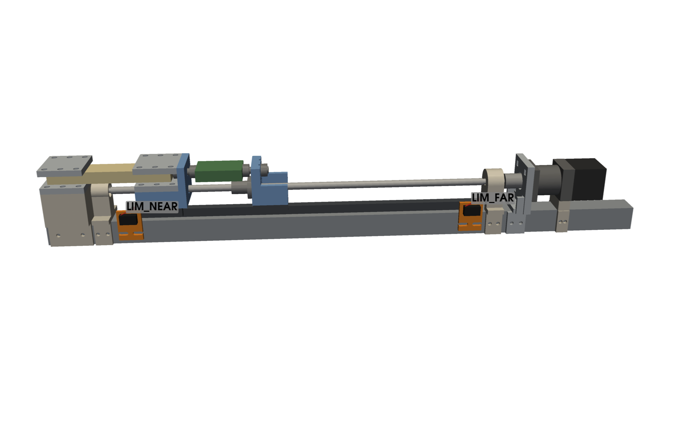
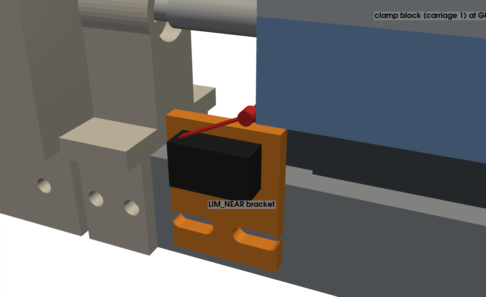
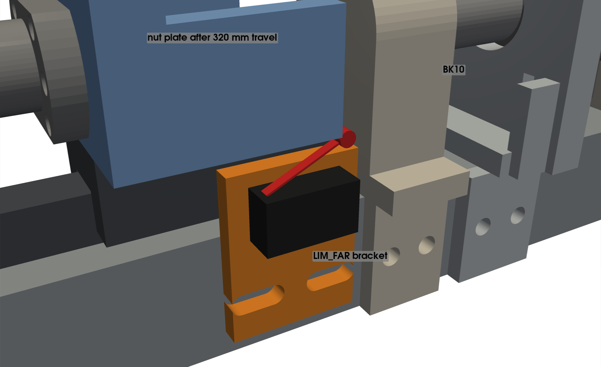

# Limit-switch mounts (LIM_NEAR, LIM_FAR) — PROPOSED

The v3e frame had no limit-switch mounts (checked against all 24 solids of
`../v3e/full_assembly_layout.step`; the CAD README listed it as open item 1). This adds one
bracket design, printed twice, for a roller-lever microswitch (KW12 / V-156 class).

## How it works

- The bracket bolts to the **-Y side slot** of the 4040 with 2x M6 + side-slot T-nuts at
  z = -20, same as the other blocks. The slots are 10 mm long, giving ±5 mm along X.
- The switch hangs outside the extrusion, under the **76 mm-wide overhang** of the moving
  parts. The bottom edge of the clamp block or nut plate (z = 28) rolls onto the roller, and
  the roller then rides on the flat underside. Overtravel never drives anything into the
  switch body: 82 mm and 59 mm of underside are available, against at most 48 mm and
  14.8 mm of travel past the trip points.
- The M3 switch holes are slotted 6 mm vertically (±3 mm), so the roller height can be set
  at install.

| Switch | Struck by | Trip point | Margin to hard stop |
|---|---|---|---|
| LIM_NEAR (J4) | clamp block on carriage 1, -X face | jaw gap ≈ 77 mm (3 mm past G0 = 80) | 48 mm before the clamp block reaches the floating block |
| LIM_FAR (J5, also the homing switch) | nut plate on carriage 2, +X face | 320 mm of travel (+X face at x = 637.2) | 14.8 mm before carriage 2 reaches the rail end |

Bracket positions: LIM_NEAR x 33.4..73.4, LIM_FAR x 607.8..647.8. LIM_FAR sits 7 mm clear
of the BK10 block (x = 655).

## Checked

Every bracket and switch body against every v3e solid, with the moving group (carriages,
clamp block, jaws, cell, studs, nut plate, ball nut) at 0, +320, +334.76 (rail end) and
-48 mm: **no collisions**. The only overlap is the free-position lever with its own striker
at and beyond the trip point. That is the lever being pressed, as intended.

## Not verified (TODO)

- **Switch dimensions are placeholders** (typical KW12-3 roller lever: 27.8 x 15.9 x 10.3
  body, 2x O3.1 at 22.2 pitch, roller R2.4, roller centre 11 mm above the body). Measure the
  real switch, update the constants at the top of `build.py`, and re-run.
- **Roller interference is set to 1.3 mm** (roller top above the strike face, lever free).
  It must be more than the switch's pre-travel (so it trips) and less than pre-travel plus
  overtravel (so it isn't crushed). Check against the switch datasheet. The vertical slots
  allow adjustment.
- The 4040 slot width (8 or 10 mm) is still unmeasured. It only changes the T-nut, not the
  bracket.
- Trip points are proposals: firmware soft limits should sit inside them. LIM_NEAR at 3 mm
  past G0 assumes the firmware never drives the jaws closer than G0 in normal use.
- Wiring: NC contact (C to NC) to GND, as the controller board expects (J4/J5).

## Files

- `build.py`: parametric source (build123d 0.13). Regenerates everything below.
- `lim_near_bracket.step/.stl`, `lim_far_bracket.step/.stl`: identical part, each at its
  assembly position. Print 2 in PETG, 6 mm plate.
- `lim_*_switch_placeholder.step`: placeholder switch body + lever, for clearance checks only.
- `images/`: renders.
